# Smart Service System — System Design

This document describes the current implementation and the target-state additions now represented by the source code and SQL schema. The system has a React web client, an Expo/React Native Android and iOS client, and a layered Express API using MySQL, with booking side effects delivered asynchronously through a transactional outbox and RabbitMQ.

## 1. System Context and Container View

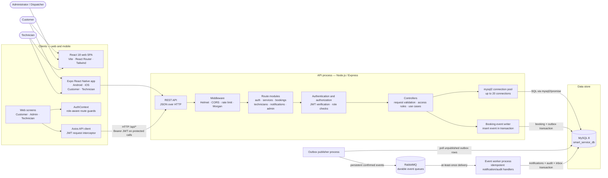

The web app, mobile app, API, outbox publisher, and event worker are separate processes. RabbitMQ and MySQL can be started locally with Docker Compose. The web app uses Axios to call the API at the browser's hostname on port `5000`; Vite serves the app on port `3000`. The Expo app calls the same API and stores its JWT in device secure storage. MySQL is configured through backend environment variables.

## 2. Backend Component View

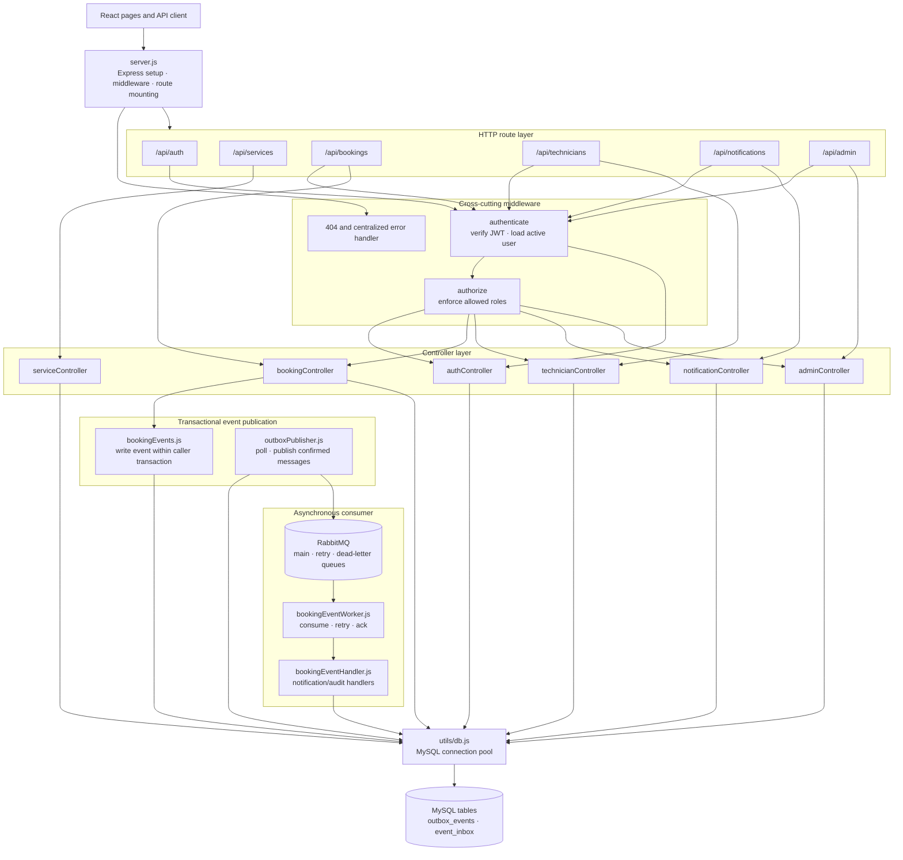

The route/controller boundaries are modules within one API process, not independently deployed business services. The booking controller writes outbox rows as part of booking transactions. A separate publisher sends confirmed messages to RabbitMQ; a worker processes them idempotently and stores notifications/audit entries in MySQL. The queues have bounded retries and a dead-letter queue. Notifications are fetched through the REST API; there is no WebSocket or external push integration.

## 3. Booking and Dispatch Workflow

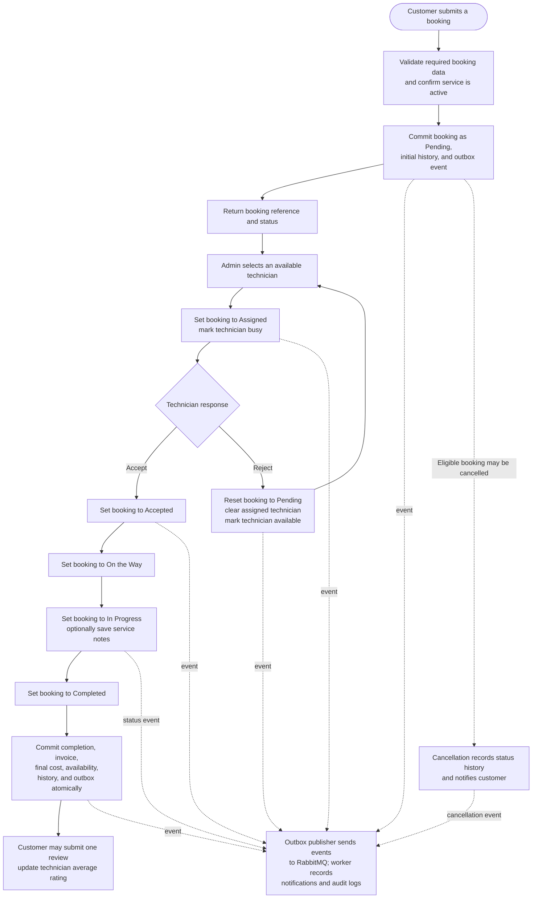

The main technician status progression is `Assigned → Accepted → On the Way → In Progress → Completed`. A rejected assignment is reset to `Pending` for reassignment. Admin actions can also update booking status. Booking state changes and outbox records are committed in one database transaction; a separate publisher and worker handle notification/audit side effects asynchronously.

## 4. Current-State Design

### 4.1 Data Model (ER Diagram)

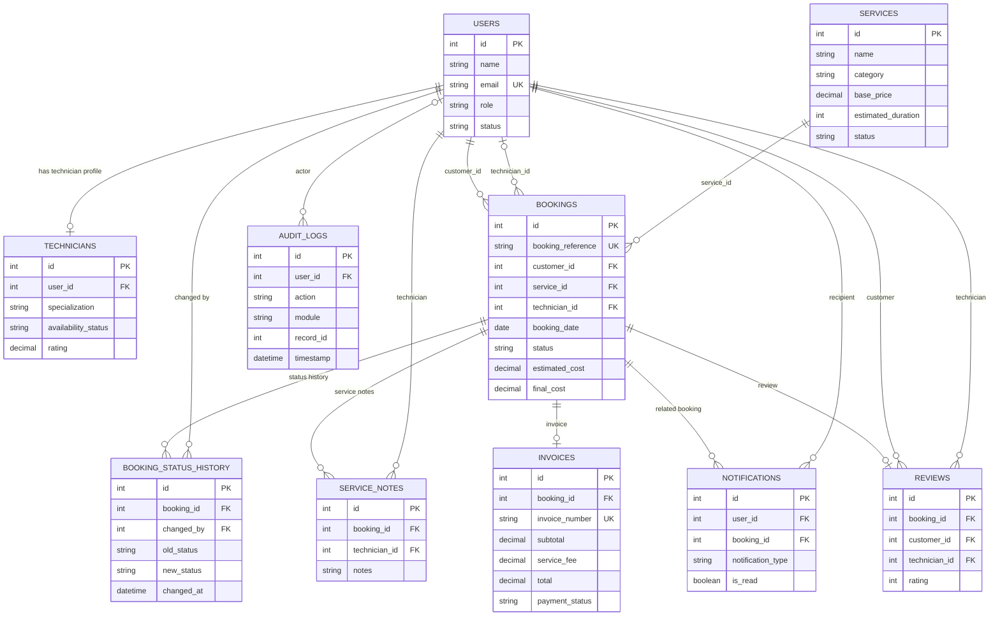

`technician_id` on a booking references the technician's `users.id`; the optional `technicians` row holds their work profile and availability. `technicians.user_id`, `invoices.booking_id`, and `reviews.booking_id` are unique foreign keys in the schema. Invoices and reviews are optional, with at most one of each per booking. Notifications may exist without a booking, and audit log actors may be null.

### 4.2 Runtime Deployment View

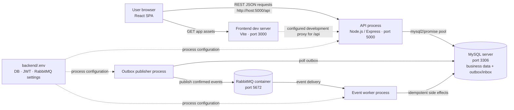

The development launcher (`start.bat`) starts the backend, outbox publisher, event worker, and frontend in separate terminal processes, and starts the RabbitMQ container through Docker Compose. The backend checks its MySQL connection before listening. No production reverse proxy, external identity provider, payment gateway, email service, or map/geocoding integration is configured.

## 5. Target-State Architecture

This section describes the target design being implemented. The transactional booking outbox, RabbitMQ publisher, and idempotent in-app notification worker are now present in the codebase. Running the full local workflow requires MySQL and Docker Desktop for RabbitMQ. Production ingress, external delivery providers, centralized observability, and CI/CD remain future operational work.

### 5.1 Target-State Process

1. **Customer requests a service:** the browser sends a synchronous REST command. The API authenticates the user, validates the request and service, and in one database transaction saves the booking, initial status history, and an outbox event.
2. **Request confirmation:** after the transaction commits, the API returns the booking reference and current status. It does not wait for email or push delivery.
3. **Event publication:** a background outbox publisher delivers committed events to a message broker. Retries and idempotency prevent transient delivery problems from losing or duplicating business effects.
4. **Dispatch and job updates:** the administrator assigns an available technician through the API. The technician accepts/rejects and reports job progress through authenticated REST commands. Booking state, status history, technician availability, and corresponding outbox records are committed together.
5. **Completion and billing:** on completion, the API transaction records the completed state, creates/updates the invoice, updates availability, and writes an event to the outbox. The customer can retrieve the invoice and booking details from the API.
6. **Notifications:** event consumers create in-app notifications in MySQL and may call an email or push provider through a notification adapter. Provider failures are retried independently of booking requests.
7. **Operations:** CI/CD validates and deploys the frontend, API, and worker. Centralized logs, health checks, metrics, alerting, backups, and database migration controls support production operation.

### 5.2 Target-State Architecture Diagram

The following diagram is a logical target. The outbox publisher, RabbitMQ broker, and event worker are implemented; the external delivery provider and operational services remain optional/future integrations.

```mermaid
flowchart LR
    People["Customers · Administrators · Technicians"]
    Browser["Responsive React web client"]
    Edge["HTTPS ingress / reverse proxy<br/>TLS · request limits · restricted CORS"]

    subgraph App["Application boundary"]
        API["Express REST API<br/>modular monolith"]
        Auth["Authentication and authorization"]
        Modules["Booking/dispatch · services/technicians<br/>billing/reviews · user management"]
        OutboxPublisher["Outbox publisher"]
        Worker["Notification/event worker"]
        NotifyAdapter["Notification adapter"]
    end

    DB[("MySQL<br/>business data + transactional outbox")]
    Broker[("Message broker")]
    InApp["In-app notifications"]
    Provider["Optional email / push provider"]
    Observability["Central logs · metrics · traces<br/>health checks · alerting"]
    Pipeline["CI/CD<br/>tests · migrations · deployment"]

    People --> Browser -->|"HTTPS"| Edge --> API
    API --> Auth --> Modules
    Modules <-->|"transactions and queries"| DB
    DB -->|"committed outbox events"| OutboxPublisher
    OutboxPublisher -->|"publish / retry"| Broker
    Broker -->|"consume events"| Worker
    Worker --> NotifyAdapter
    NotifyAdapter -->|"persist notification"| InApp
    InApp --> DB
    NotifyAdapter -. "optional delivery" .-> Provider
    API -. "logs / metrics / traces" .-> Observability
    OutboxPublisher -. "logs / metrics" .-> Observability
    Worker -. "logs / metrics" .-> Observability
    Pipeline -. "build and deploy" .-> Browser
    Pipeline -. "build and deploy" .-> API
    Pipeline -. "build and deploy" .-> Worker
```

The local implementation uses RabbitMQ through Docker Compose. It does not prescribe a production cloud provider or deployment platform.

### 5.3 Architecture Style Selection

**Selected target style: layered modular monolith with asynchronous event-driven integration.**

| Option | Decision | Reason |
|---|---|---|
| Layered modular monolith | Adopt | Preserves the current React + Express + MySQL foundation while defining clear business modules and interfaces. It is the lowest-risk evolution for the current project. |
| Event-driven processing for side effects | Adopt selectively | Booking state changes remain transactional API operations; non-critical effects such as notifications are processed asynchronously so provider latency/failure does not block booking workflows. |
| Microservices | Defer | Separate services add deployment, network, data ownership, and observability costs. The current codebase and demonstrated scale do not justify that complexity. Reconsider only when independent scaling, release cadence, team ownership, or isolation requirements make the benefits measurable. |
| Synchronous REST | Retain for commands and queries | The browser needs immediate validation and booking results, and the existing API already uses REST/JSON. |

Modules should own their business rules and expose application-level interfaces. They may share the existing MySQL database initially, but cross-module writes should be explicit and transaction boundaries documented. A future extraction into separate services should not be assumed by this proposal.

### 5.4 Integration Pattern Selection

| Interaction | Target pattern | Contract and reliability |
|---|---|---|
| Web/mobile clients ↔ API | Synchronous REST over HTTPS with JSON | Shared API contract; JWT bearer authentication; role checks; bounded requests; explicit status/error response formats. Mobile tokens are stored in device secure storage. |
| API ↔ MySQL | Synchronous parameterized SQL transactions | Keep booking state, status history, invoice effects, and outbox event creation atomic where they form one business operation. |
| API ↔ background processing | Transactional outbox plus asynchronous broker messaging | Implemented: booking changes and outbox events commit together; a separate publisher sends confirmed persistent messages. |
| Broker ↔ consumer | At-least-once delivery with idempotent consumers | Implemented: an inbox table makes event side effects idempotent; failures are retried and eventually routed to a dead-letter queue. |
| Notification worker ↔ external provider | Adapter interface with timeouts and retries | Treat email/push as optional integrations; isolate credentials, respect provider limits, and record delivery outcomes without changing booking truth. |
| Admin/operations ↔ observability | Structured telemetry | Correlate API requests and events with request/event IDs; exclude passwords, JWTs, and other secrets from logs. |

The current project implements browser-to-REST, API-to-MySQL, and transactional-outbox-to-RabbitMQ integration. External delivery providers and centralized observability remain proposed and require implementation.

### 5.5 Architecture Decision Record

#### ADR-001: Evolve to a modular monolith with reliable asynchronous side effects

| Field | Decision record |
|---|---|
| Status | Accepted; outbox, RabbitMQ publisher, and idempotent worker implemented. End-to-end runtime validation requires Docker Desktop and a configured MySQL instance. |
| Date | 2026-10-09 |
| Context | Before this decision was implemented, the small single-backend application executed booking notification and audit side effects synchronously. This coupled request latency and success to non-critical work; publishing directly after a database change would also risk losing events if a process failed between writes. |
| Decision | Retain one Express deployment and MySQL as the system of record. Organize backend capabilities into explicit modules. Keep booking commands synchronous. Use a MySQL transactional outbox to record integration events with business changes, publish those events asynchronously to a broker, and process notifications in idempotent workers. |
| Rationale | This reduces operational complexity compared with microservices while creating a reliable seam for slow or failure-prone side effects. The outbox addresses the database/broker dual-write problem; at-least-once delivery with idempotent consumers makes retries safe. |
| Alternatives considered | (1) Keep all effects synchronous: simplest but couples response time and availability to notification delivery. (2) Publish directly to a broker after the database commit: risks a committed booking with a lost event if publication fails. (3) Adopt microservices now: adds operational and data-consistency complexity without evidenced need. |
| Consequences | The implementation adds outbox/inbox tables, RabbitMQ infrastructure, publisher and worker processes, retry/dead-letter handling, and event contracts. Eventual consistency means a notification may appear shortly after the booking response. MySQL remains authoritative for booking state and in-app notifications. |
| Guardrails | Do not move booking truth into the broker. Events have IDs, names, timestamps, and aggregate IDs; consumers are idempotent. Retries are bounded and failed messages go to a dead-letter queue. Monitor dead-letter events and outbox backlog before production rollout. Keep sensitive personal data out of event payloads where possible. |

## 6. System Design Diagrams

### 6.1 Use-Case Diagram

The diagram shows the main user goals supported by the current system. Role access is enforced by both frontend route guards and backend authorization middleware.

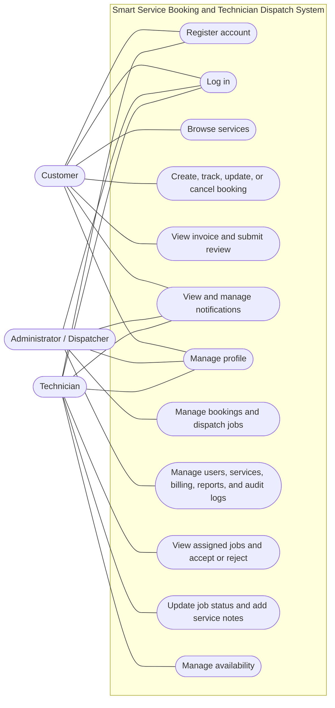

### 6.2 Context Diagram

This level-0 context view treats the application as one system and shows the external people who exchange information with it. Database and internal components are intentionally left inside the system boundary.

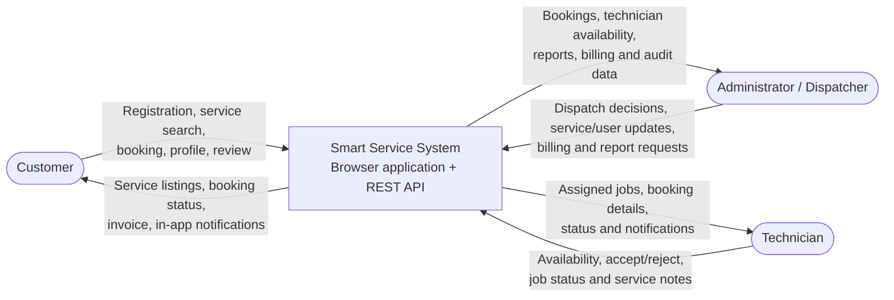

No external payment, email/SMS, mapping, identity-provider, or push-notification system is connected in the current project.

### 6.3 Data-Flow Diagram

This level-1 DFD shows the main application processes and persistent data stores. Booking notification and audit side effects are handled by a separate worker process that writes to MySQL; the worker is part of this application, not an independently owned microservice.

```mermaid
flowchart LR
    Customer([Customer])
    Admin([Administrator / Dispatcher])
    Tech([Technician])

    P1(["1. Authenticate and manage profiles"])
    P2(["2. Browse and manage services"])
    P3(["3. Create and manage bookings"])
    P4(["4. Dispatch and perform service"])
    P5(["5. Complete billing and reviews"])
    P6(["6. Create and retrieve notifications"])
    P7(["7. Record audit activity"])
    P8(["8. Publish committed outbox events"])
    P9(["9. Consume events idempotently"])

    D1[("D1 Users and technician profiles")]
    D2[("D2 Services and bookings")]
    D3[("D3 Status history and service notes")]
    D4[("D4 Invoices and reviews")]
    D5[("D5 Notifications and audit logs")]
    D6[("D6 Transactional outbox and consumer inbox")]
    D7[("D7 RabbitMQ durable event queues")]

    Customer -->|"Credentials and profile data"| P1
    P1 -->|"Session JWT and account result"| Customer
    P1 <-->|"User and role records"| D1

    Customer -->|"Service search"| P2
    Admin -->|"Service maintenance"| P2
    P2 -->|"Service catalog"| Customer
    P2 <-->|"Service records"| D2

    Customer -->|"Booking request or change"| P3
    P3 -->|"Booking reference and status"| Customer
    P3 <-->|"Booking records"| D2
    P3 -->|"Initial status history"| D3
    P3 -->|"Booking event in same transaction"| D6

    Admin -->|"Technician assignment"| P4
    Tech -->|"Accept/reject, progress, notes"| P4
    P4 -->|"Assigned jobs and booking details"| Tech
    P4 -->|"Dispatch and job results"| Admin
    P4 <-->|"Bookings and technician availability"| D1
    P4 <-->|"Booking records"| D2
    P4 -->|"Status history and service notes"| D3
    P4 -->|"Assignment/status events in same transaction"| D6

    P4 -->|"Completed service details"| P5
    Customer -->|"Rating and review"| P5
    Admin -->|"Payment status update"| P5
    P5 -->|"Invoice and review details"| Customer
    P5 -->|"Billing records and reports"| Admin
    P5 <-->|"Invoices and reviews"| D4
    P5 -->|"Completion event in same transaction"| D6

    D6 -->|"Unpublished events"| P8
    P8 -->|"Persistent confirmed messages"| D7
    D7 -->|"At-least-once event delivery"| P9
    P9 -->|"Notification effects"| P6
    P9 -->|"Audit effects"| P7

    P6 <-->|"Notification records"| D5
    P6 -->|"In-app notifications"| Customer
    P6 -->|"In-app notifications"| Tech
    P6 -->|"In-app notifications"| Admin
    P7 -->|"Audit records"| D5
    P9 <-->|"Processed event IDs"| D6
    Admin -->|"Audit-log query"| P7
    P7 -->|"Audit history"| Admin
```

### 6.4 Sequence Diagram

The sequence below describes booking through completion. The API commits business state and outbox events synchronously; a separate publisher and worker process notifications and audit side effects asynchronously. Notifications are stored in MySQL and later fetched by each user's client.

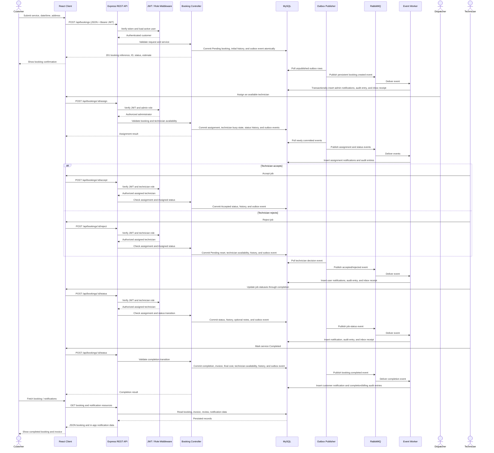

### 6.5 Database Design

The database design is implemented in [`database/schema.sql`](../database/schema.sql). The business data uses relational primary/foreign keys; the outbox has an index for scanning unpublished events.

| Table | Purpose and principal columns | Keys and constraints |
|---|---|---|
| `users` | Accounts: `id`, `name`, `email`, `phone`, `password_hash`, `role`, `status`, timestamps | `id` PK; `email` unique; role is customer/technician/admin |
| `technicians` | Technician-specific data: `user_id`, `specialization`, `availability_status`, `experience`, `rating`, `current_location` | `id` PK; `user_id` unique FK to `users.id` |
| `services` | Service catalog: `name`, `description`, `category`, `base_price`, `estimated_duration`, `status` | `id` PK |
| `bookings` | Customer request and lifecycle: reference, customer, service, optional technician, schedule, address/coordinates, status, estimated/final cost | `id` PK; `booking_reference` unique; FKs to `users.id` (customer and technician) and `services.id` |
| `booking_status_history` | Booking state changes: `booking_id`, old/new status, actor, timestamp | `id` PK; FKs to `bookings.id` and `users.id` |
| `service_notes` | Technician notes on a booking: booking, technician, note, timestamp | `id` PK; FKs to `bookings.id` and `users.id` |
| `invoices` | One invoice per booking: invoice number, subtotal, fee, total, payment status | `id` PK; `booking_id` unique FK; `invoice_number` unique |
| `notifications` | In-app messages: recipient, optional booking, title, message, type, read flag, timestamp | `id` PK; FKs to `users.id` and nullable `bookings.id` |
| `reviews` | Customer rating/comment for completed work | `id` PK; `booking_id` unique FK; customer and technician FKs to `users.id`; rating constrained to 1–5 |
| `audit_logs` | Audit action, module, optional actor/record, description, IP and timestamp | `id` PK; nullable actor FK to `users.id` |
| `outbox_events` | Booking integration events awaiting broker publication: aggregate, event type, JSON payload, publish timestamp/attempt count/error | UUID `id` PK; index on `(published_at, created_at)` |
| `event_inbox` | Event IDs already applied by the worker, preventing duplicate notification/audit side effects | `event_id` PK |

Important relationships and integrity rules:

- One user may have one technician profile; a technician profile is optional and `technicians.user_id` is unique.
- Each booking references exactly one customer and one service; it may reference a technician until assignment or reassignment.
- A booking can have many status-history entries, service notes, and notifications.
- A booking can have at most one invoice and one review because their `booking_id` columns are unique.
- Notification booking references and audit-log user references may be null; the schema uses `ON DELETE SET NULL` for those nullable relationships.
- User deletion cascades to technician profiles and notifications; booking status history and service notes cascade when a booking is deleted.
- Prices and totals use `DECIMAL(10,2)`; booking schedule uses `DATE` and `TIME`; role and lifecycle values use `ENUM` constraints where defined.

### 6.6 User Interface Design

The React application uses public routes and role-protected layouts. Each role receives a different navigation shell and set of screens.

```mermaid
flowchart TD
    Visitor([Visitor])
    Customer([Customer])
    Admin([Administrator])
    Tech([Technician])

    Landing["Public: Landing page"]
    Login["Login"]
    Register["Register"]

    CustomerShell["Customer layout"]
    CustomerHome["Dashboard"]
    Services["Services and booking form"]
    MyBookings["Bookings and booking details"]
    CustomerNotifs["Notifications"]
    CustomerProfile["Profile"]

    AdminShell["Admin layout"]
    AdminHome["Dashboard"]
    Dispatch["Bookings and dispatch"]
    AdminManage["Users, technicians, services"]
    AdminOps["Billing, reports, audit logs,<br/>notifications, settings"]

    TechShell["Technician layout"]
    TechHome["Dashboard"]
    Jobs["Jobs and job details"]
    TechNotifs["Notifications"]
    TechProfile["Profile and availability"]

    Visitor --> Landing
    Visitor --> Login
    Visitor --> Register
    Login -->|"role = customer"| CustomerShell
    Login -->|"role = admin"| AdminShell
    Login -->|"role = technician"| TechShell
    Customer --> CustomerShell
    Admin --> AdminShell
    Tech --> TechShell

    CustomerShell --> CustomerHome
    CustomerShell --> Services
    CustomerShell --> MyBookings
    CustomerShell --> CustomerNotifs
    CustomerShell --> CustomerProfile

    AdminShell --> AdminHome
    AdminShell --> Dispatch
    AdminShell --> AdminManage
    AdminShell --> AdminOps

    TechShell --> TechHome
    TechShell --> Jobs
    TechShell --> TechNotifs
    TechShell --> TechProfile
```

#### Screen layout and interaction pattern

| UI area | Design described by the current app |
|---|---|
| Shared application shell | Responsive navigation and page content; role-specific layouts keep customer, admin, and technician functions separate. |
| Customer screens | Dashboard, service catalog/booking form, booking list and detail/timeline, notifications, profile, and completed-job invoice/review details. |
| Admin screens | Dashboard and charts, booking list/detail, dispatch, user/technician/service management, billing, reports, audit logs, notifications, and settings. |
| Technician screens | Dashboard, assigned jobs/list and detail, job controls/status progression, service notes, notifications, profile, and availability. |
| Forms and feedback | Forms exchange JSON through the API client; pages use loading, empty, and error states and the app uses toast notifications for feedback. |
| Responsive behavior | The project documentation describes mobile-first layouts, with a sidebar on desktop and compact/bottom navigation on smaller screens. |

The UI diagram is a navigation and screen-structure model, not a pixel-accurate visual mockup. Detailed colors, spacing, typography, and accessibility acceptance criteria are not specified as a formal design system in the scanned project.

## 7. Cross-Cutting Design

- **Authentication:** bcryptjs password hashing and JWT bearer tokens; protected API requests reload the active user from MySQL.
- **Authorization:** Express route middleware restricts operations by `customer`, `technician`, and `admin` role; booking queries additionally scope customer and technician results.
- **Persistence:** Controllers and booking hooks use parameterized MySQL queries through the shared `mysql2/promise` pool.
- **Notifications and audit:** Both are persisted as application data in MySQL. Booking-event side effects are processed asynchronously through RabbitMQ; in-app notifications are fetched through the REST API.
- **Transport:** JSON REST endpoints under `/api`; the browser's Axios client attaches the JWT to requests.
- **Error handling:** Express has a not-found response and centralized error middleware; controllers return JSON error responses.

## 8. Requirements

The functional requirements below describe capabilities present in the scanned frontend, backend, and schema. Nonfunctional requirements distinguish implementation evidence from operational targets that the project does not currently define.

### 8.1 Functional Requirements

| ID | Requirement |
|---|---|
| FR-01 | The system shall allow users to register and log in, and shall support customer, technician, and administrator roles. |
| FR-02 | The system shall allow authenticated users to view and update their profile; users shall be able to change their password. Technicians shall also be able to update their specialization and availability. |
| FR-03 | The system shall allow users to browse active service offerings and allow administrators to create, update, or deactivate service offerings. |
| FR-04 | The system shall allow customers to create service bookings with service, requested date/time, address, and optional description and location coordinates. A new booking shall begin in `Pending` status. |
| FR-05 | The system shall allow users to list and view booking details. Customers shall see their own bookings, technicians their assigned bookings, and administrators all bookings. |
| FR-06 | The system shall allow eligible users to modify or cancel bookings, subject to ownership and booking-status rules. |
| FR-07 | The system shall allow administrators to view available technicians and assign a technician to an eligible booking. Assignment shall update booking status and technician availability. |
| FR-08 | The system shall allow technicians to accept or reject assigned jobs. Rejection shall return the booking to `Pending` for reassignment. |
| FR-09 | The system shall support technician job-status updates through `Accepted`, `On the Way`, `In Progress`, and `Completed`; technicians may add service notes during work. |
| FR-10 | The system shall record booking status history and relevant audit events, including booking creation, assignment, status changes, and service completion. |
| FR-11 | On service completion, the system shall create or update an invoice, calculate a 10% service fee from the estimated cost, save the final cost, and return the technician to available status. |
| FR-12 | The system shall allow customers to submit one rating and optional comment for a completed booking and update the technician's average rating. |
| FR-13 | The system shall create in-app notifications for relevant booking events, allow users to view their notifications, and allow them to mark notifications read individually or all at once. |
| FR-14 | The system shall provide administrator views for dashboard statistics, booking and technician reports, user management, billing/payment status, notifications, and audit logs. |
| FR-15 | The system shall expose a health endpoint reporting API status and timestamp. |

### 8.2 Nonfunctional Requirements

| ID | Requirement | Evidence / current limitation |
|---|---|---|
| NFR-01 Security | Passwords shall not be stored in plain text; protected operations shall authenticate the caller and enforce role permissions. | Passwords are hashed with bcryptjs; JWT authentication and role middleware are implemented. |
| NFR-02 Data protection | Database operations involving user input shall use parameterized queries, and responses shall not expose stored password hashes. | mysql2 prepared execution is used throughout the examined controllers; login removes `password_hash` from the returned user object. |
| NFR-03 Web security | The API shall apply standard security headers and limit abusive request rates. | Helmet and express-rate-limit are enabled. Production HTTPS and a restricted production CORS origin are not established by the current configuration; the server currently allows `origin: '*'`. |
| NFR-04 Data integrity | Stored entities shall preserve defined relationships and key uniqueness constraints. | MySQL foreign keys and unique constraints are defined for user email, booking reference, technician profile, invoice per booking, and review per booking. Booking state, history, completion billing, and outbox writes use MySQL transactions; not every unrelated profile/admin workflow is transaction-wrapped. |
| NFR-05 Performance | The system shall reuse database connections and avoid unbounded list responses. | A MySQL connection pool is configured with a maximum of 20 connections; booking lists support pagination, and notification retrieval is capped at 50 records. No measured latency or throughput target is specified. |
| NFR-06 Availability and recovery | The API shall detect database connectivity failure at startup and expose a health-check endpoint. | Startup tests the database connection and exits on failure; `/api/health` returns an API status response. Uptime targets, backups, failover, and disaster-recovery procedures are not specified. |
| NFR-07 Usability and compatibility | The application shall support customer, administrator, and technician tasks on desktop and mobile-sized screens. | The project describes a responsive mobile-web UI and contains separate role-based layouts. A formal browser/device support matrix is not specified. |
| NFR-08 Maintainability | The system shall separate presentation, routing, request handling, shared side effects, and persistence concerns. | React pages, Express routes/controllers, event handlers, services, and database utilities are organized into separate modules within a single application. |
| NFR-09 Observability | The system shall provide operational request logging and actionable error reporting. | Morgan request logging and server/controller error logging are present. Centralized log aggregation, metrics, alerting, and tracing are not configured. |
| NFR-10 Responsiveness | The client shall avoid waiting indefinitely for API responses. | Axios requests have a 15-second timeout. No broader end-to-end service-level response objective is specified. |

No formal availability percentage, concurrent-user capacity, recovery-time objective, recovery-point objective, or production performance benchmark is stated in the project. These should be agreed and tested before production deployment rather than inferred from the development configuration.

### 8.3 Interface and Data Exchange Requirements

#### User interfaces

- The system shall provide browser-based interfaces for public visitors, customers, administrators/dispatchers, and technicians.
- Public users shall be able to access the landing, login, and registration screens. Authenticated role-specific screens shall be protected by frontend route guards and corresponding backend authorization.
- The customer interface shall support service discovery, booking creation and tracking, notifications, profile management, invoice viewing, and reviews.
- The technician interface shall support assigned jobs, job status updates, service notes, availability, notifications, and profile management.
- The administrator interface shall support dispatch, booking and user management, services, billing, reports, audit logs, and operational dashboards.

#### Client-to-API exchange

- The frontend and backend shall exchange JSON over HTTP using REST endpoints under `/api`; the documented development ports are `3000` for the frontend and `5000` for the API.
- Requests shall use resource-oriented paths and HTTP methods. The implemented route groups are `/auth`, `/services`, `/bookings`, `/technicians`, `/notifications`, and `/admin`.
- Protected requests shall include a JWT bearer token in the `Authorization` header. The client stores the token in browser local storage and attaches it to API requests.
- Request bodies shall use JSON for operations such as registration, login, booking creation, technician assignment, status updates, reviews, and profile changes. Query parameters are used for list filters and pagination.
- Responses shall use JSON. Successful responses commonly include `success: true`, a message, and resource data; errors include `success: false` and a human-readable message. Booking lists include pagination metadata.
- Invalid or expired authentication shall produce an unauthorized response; insufficient role permissions shall produce a forbidden response. The frontend clears local authentication and navigates to login when it receives a `401`.
- The API accepts JSON request bodies up to 10 MB and uses a 15-second timeout in the browser API client.

#### API-to-database exchange

- The API shall persist users, technician profiles, services, bookings, booking status history, service notes, invoices, notifications, reviews, and audit logs in the `smart_service_db` MySQL database.
- The backend shall connect using the `mysql2/promise` driver and configuration supplied through backend environment variables. Database values supplied by users shall be passed as query parameters rather than interpolated into SQL.
- Booking state changes, status history, invoices, and outbox events shall be committed atomically in MySQL. The publisher sends versioned events to RabbitMQ; an idempotent worker persists notifications and audit logs in MySQL and records processed IDs in the inbox.
- Date/time and monetary values shall follow the SQL types and constraints in `database/schema.sql`. The application sets its server timezone to `Asia/Manila` and configures the database connection timezone as `+08:00`.

#### External interfaces and protocol boundaries

- The project defines no external identity provider, payment processor, email/SMS gateway, push-notification service, or map/geocoding provider. RabbitMQ is the implemented internal event transport.
- The frontend API client currently constructs an `http://` API URL using the browser hostname and port `5000`; the development Vite server also defines a proxy for `/api`. Production TLS termination, API URL configuration, and CORS allowlisting remain deployment requirements rather than implemented external interfaces.
